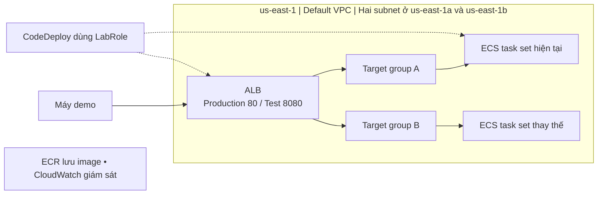

# BÁO CÁO TIẾN ĐỘ TUẦN 1

Blue/Green deployment cho ECS với AWS CodeDeploy

Môn học Cloud 2026–2027  |  GVHD Huỳnh Xuân Phụng

Sinh viên: Nguyễn Công Khoa / MSSV: 24110254    Sinh viên: Nguyễn Tiến Đạt / MSSV: 24110194

## 1 Mục tiêu và kết quả tuần 1

Tuần 1 tập trung tìm hiểu dịch vụ, thiết kế kiến trúc và chuẩn bị nền tảng. Đã kiểm tra môi trường Learner Lab, xây dựng tài liệu blue/green, chọn mạng có sẵn và tạo hai security group.

## 2 Kiểm tra AWS Learner Lab

Đã truy cập AWS Console tại us-east-1; Account ID 217376138299. Ngân sách đã dùng 0 USD trên 50 USD.

Readme cho phép ECS, Fargate, CodeDeploy, ELB, ECR và CloudWatch. Trust của LabRole có CodeDeploy và ECS task; Dùng role có sẵn, không tạo IAM user/role mới.

## 3 Tìm hiểu và thiết kế kiến trúc

Blue là phiên bản hiện tại, green là bản thay thế. CodeDeploy tạo task set mới, kiểm tra health và điều chỉnh traffic qua ALB. Hai target group A/B đổi vai trò giữa các lần triển khai. Rollback theo điều kiện thất bại hoặc alarm phải được cấu hình và xác minh bằng deployment events.

Thiết kế dự kiến dùng một ECS service với controller CODE_DEPLOY, Fargate 0,25 vCPU / 512 MiB, desired count 1; hai target group loại ip, HTTP 8080. Chọn canary 10% trong năm phút, rồi chuyển phần còn lại nếu deployment tiếp tục bình thường.

Hình 1  Kiến trúc blue/green dự kiến trên ECS.

## 4 Nền tảng AWS và Git đã chuẩn bị

| Hạng mục | Kết quả ghi nhận |
| --- | --- |
| VPC và subnet | Tái sử dụng default VPC vpc-01cefe25cf51f1293 (172.31.0.0/16). A: subnet-0dd4e6a728f1a7476, us-east-1a, 172.31.16.0/20. B: subnet-039825a0b49e43f75, us-east-1b, 172.31.32.0/20. |
| Route ra Internet | Main route table rtb-02f08db969e7a3be8 có route 0.0.0.0/0 tới igw-033330f9a6a5ae975, trạng thái Active. |
| bg-alb-sg | Đã tạo sg-0b2f0910bab760484. Inbound TCP 80/8080 từ IP máy demo 171.250.165.238/32. Outbound TCP 8080 tới bg-task-sg đã lưu thành công. |
| bg-task-sg | Đã tạo sg-09c234bb4a8e6fbcf. Inbound TCP 8080 từ bg-alb-sg; outbound HTTPS 443 tới 0.0.0.0/0. |
| Tags | Đã điền Project=ecs-bluegreen-demo và Owner=khoa-dat ở form tạo hai SG. |
| Git và minh chứng | Repository có branch main và remote origin trỏ tới toilacongkhoa/Final-cloud-computing. |

## 5 Worklog

| Công việc tuần 1 | Người thực hiện | Giờ ước tính |
| --- | --- | --- |
| 1. Kiểm tra Learner Lab, Region, ngân sách và LabRole. | Nguyễn Công Khoa | 1,5 |
| 2. Tìm hiểu ECS/Fargate, ECR, task definition và ALB. | Nguyễn Tiến Đạt | 2 |
| 3. Tìm hiểu CodeDeploy, chuyển traffic và rollback. | Nguyễn Tiến Đạt | 2 |
| 4. Thiết kế và rà soát sơ đồ kiến trúc blue/green. | Nguyễn Tiến Đạt | 2,5 |
| 5. Kiểm tra VPC, subnet, route table và Internet Gateway. | Nguyễn Công Khoa | 1,5 |
| 6. Tạo hai security group, cấu hình rules và điền tags. | Nguyễn Công Khoa | 2 |
| 7. Đối chiếu IDs, ports, source/destination và tags. | Nguyễn Tiến Đạt | 1,5 |
| 8. Tổ chức repository, tài liệu và 14 ảnh minh chứng. | Nguyễn Công Khoa | 1,5 |
| 9. Tổng hợp worklog và báo cáo tuần 1. | Nguyễn Công Khoa | 1,5 |

AI hỗ trợ: giải thích dịch vụ và cấu hình, tổng hợp tài liệu, vẽ sơ đồ, đối chiếu minh chứng và biên soạn báo cáo.

## 6 Minh chứng

Hình 2  Trạng thái Learner Lab và ngân sách.

Hình 3  AWS Console và Region us-east-1.

Hình 4  Lỗi quyền đọc IAM policy.

Hình 5  Default VPC có sẵn.

Hình 6  Danh sách subnet và CIDR.

Hình 7  Availability Zones và route table.

Hình 8  Route ra Internet ở trạng thái Active.

Hình 9  Form cấu hình inbound của bg-alb-sg.

Hình 10  Form điền tags Project/Owner cho bg-alb-sg.

Hình 11  Tạo bg-alb-sg thành công.

Hình 12  Form cấu hình rules và tags của bg-task-sg.

Hình 13  Tạo bg-task-sg thành công.

Hình 14  Form cấu hình outbound TCP 8080 tới bg-task-sg.

Hình 15  Lưu outbound của bg-alb-sg thành công.
