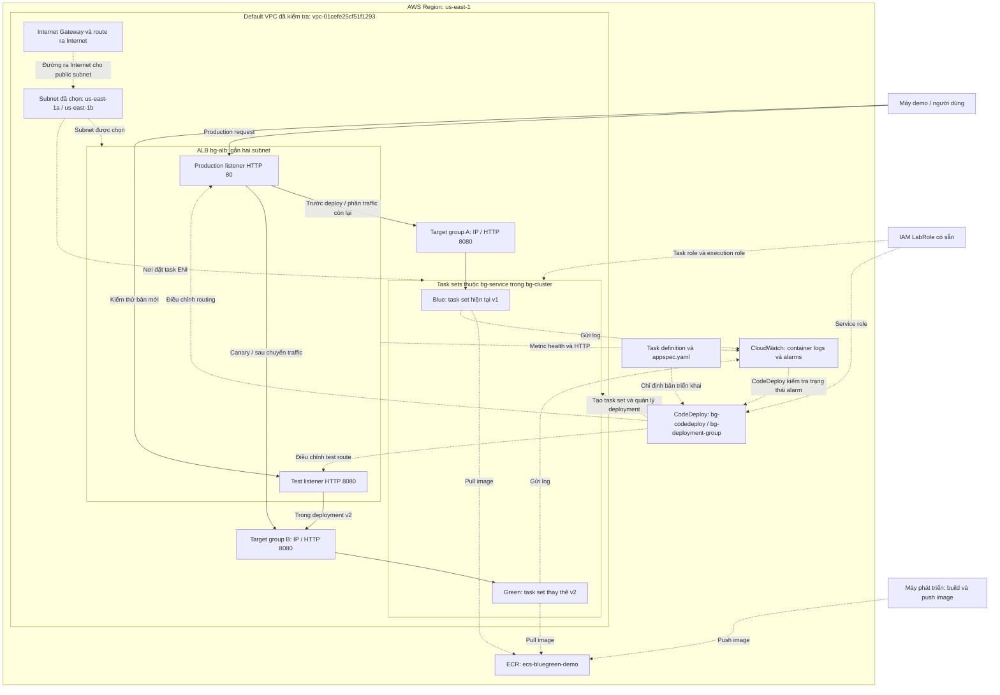

# Sơ đồ kiến trúc ECS Blue/Green với AWS CodeDeploy — Tuần 1

**Trạng thái:** Thiết kế tổng thể dự kiến; VPC/subnet/route có sẵn đã được kiểm tra và hai security groups đã được tạo theo minh chứng ngày 10/10/2026. ECS, ALB, ECR, CloudWatch và CodeDeploy chưa có minh chứng triển khai trong bộ ảnh tuần 1.

**Mục tiêu:** Chạy ứng dụng demo trên ECS Fargate, kiểm tra bản mới, chuyển traffic bằng CodeDeploy và minh họa rollback tự động khi deployment gặp lỗi.

## 1. Sơ đồ tổng thể

**Chú thích:** Mũi tên liền biểu diễn request ứng dụng; mũi tên nét đứt thể hiện thao tác quản lý, lấy image, giám sát hoặc quan hệ cấu hình. Hình biểu diễn quan hệ logic; không có nghĩa traffic ứng dụng đi qua CodeDeploy hoặc ECR.

Sơ đồ thể hiện lần triển khai v1 → v2. Production không gửi tới cả hai target group ở mọi thời điểm: ban đầu đi A, giai đoạn canary có thể chia A/B, sau thành công đi B. Test listener ban đầu cũng trỏ về target group đang phục vụ; CodeDeploy điều chỉnh nó khi deployment bắt đầu. [Workflow ECS CodeDeploy](https://docs.aws.amazon.com/codedeploy/latest/userguide/deployment-steps-ecs.html).

## 2. Cấu hình dự kiến

| Thành phần | Cấu hình cho bài lab |
| --- | --- |
| Region | `us-east-1`, giữ cùng Region cho tài nguyên của bài |
| ECR repository | `ecs-bluegreen-demo`; tag image riêng cho mỗi bản build |
| ECS cluster / service | `bg-cluster` / `bg-service`; controller `CODE_DEPLOY` |
| Nền tảng chạy task | Fargate Linux, kiến trúc X86_64, network mode `awsvpc` |
| Kích thước task | Khởi đầu 0,25 vCPU và 512 MiB RAM |
| Desired count | 1; cần thêm capacity cho task set thay thế khi deployment |
| Container | `web`, nghe trên `0.0.0.0:8080` |
| ALB | `bg-alb`, internet-facing, hai subnet khác AZ |
| Listeners | Production HTTP 80; test HTTP 8080 trên cùng ALB |
| Target groups | `bg-tg-a`, `bg-tg-b`, target type `ip`, HTTP 8080 |
| ALB health check | `/health`, mong đợi HTTP 200 |
| CodeDeploy | Application `bg-codedeploy`, deployment group `bg-deployment-group` |
| Traffic shifting | `CodeDeployDefault.ECSCanary10Percent5Minutes` |
| Logs | Log group `/ecs/bg-demo`, retention dự kiến bảy ngày |
| Tags | `Project=ecs-bluegreen-demo`, `Owner=khoa-dat` trên tài nguyên của nhóm hỗ trợ tag |

Đây là lựa chọn thực hành dựa trên hướng dẫn hiện có của dự án. Một task mỗi phiên bản phù hợp demo nhỏ; việc chọn hai subnet không đồng nghĩa luôn có task chạy đồng thời ở cả hai AZ. Blue và green cũng không bị cố định vào hai AZ khác nhau.

Nguồn cấu hình: [Fargate task definition](https://docs.aws.amazon.com/AmazonECS/latest/developerguide/task_definition_parameters.html), [ALB cho ECS](https://docs.aws.amazon.com/AmazonECS/latest/developerguide/alb.html).

## 3. Mạng và security groups

Nền tảng đã đối chiếu từ ảnh tuần 1:

| Thành phần | ID / cấu hình thực tế |
| --- | --- |
| VPC có sẵn | `vpc-01cefe25cf51f1293`, default VPC, `172.31.0.0/16` |
| Subnet A được chọn | `subnet-0dd4e6a728f1a7476`, `us-east-1a`, `172.31.16.0/20` |
| Subnet B được chọn | `subnet-039825a0b49e43f75`, `us-east-1b`, `172.31.32.0/20` |
| Main route table | `rtb-02f08db969e7a3be8`; route Internet Active |
| Internet Gateway | `igw-033330f9a6a5ae975` |
| ALB security group đã tạo | `bg-alb-sg` / `sg-0b2f0910bab760484` |
| Task security group đã tạo | `bg-task-sg` / `sg-09c234bb4a8e6fbcf` |

Hai subnet là lựa chọn cho bước triển khai, chưa được gắn vào ALB/ECS trong bộ minh chứng. Xem [báo cáo nền tảng](CHUAN_BI_NEN_TANG_AWS_VA_GIT.md) để đối chiếu rules, tags và ảnh cấu hình. Các subnet và route table được tái sử dụng, không phải tài nguyên nhóm tạo mới.

Hai public subnet có route `0.0.0.0/0` qua Internet Gateway. Chọn cả hai subnet cho ALB và network configuration của ECS service. Với phương án Fargate public subnet, bật `assignPublicIp=ENABLED` để task có đường lấy image và gửi log mà không cần dựng NAT Gateway cho demo này.

ALB kết nối tới **private IP của task ENI** trong VPC. Public IP của task dùng cho đường ra Internet trong phương án này; không phải địa chỉ cần đăng ký thủ công vào target group. [Kết nối Internet của ECS Fargate](https://docs.aws.amazon.com/AmazonECS/latest/developerguide/networking-outbound.html).

| Security group | Quy tắc đã cấu hình theo ảnh |
| --- | --- |
| `bg-alb-sg` inbound | TCP 80 và 8080 từ `171.250.165.238/32`, IP máy demo lúc cấu hình |
| `bg-alb-sg` outbound | TCP 8080 tới `bg-task-sg` |
| `bg-task-sg` inbound | TCP 8080, nguồn là `bg-alb-sg` |
| `bg-task-sg` outbound | HTTPS 443 tới `0.0.0.0/0`; chưa kiểm thử lấy image/gửi log từ task chạy thật |

Nếu IP máy demo thay đổi, cập nhật nguồn được phép trong SG ALB. HTTP được chọn cho ứng dụng demo không chứa dữ liệu nhạy cảm; khi thay đổi phạm vi sử dụng, cần thiết kế lại yêu cầu bảo mật tương ứng.

## 4. IAM, image và cấu hình triển khai

Theo Readme của Learner Lab đã kiểm tra:

- CodeDeploy dùng `LabRole` làm service role.
- ECS chọn `LabRole` cho task role và task execution role.
- Người dùng lab có quyền ghi ECR; `LabRole` có quyền đọc ECR để task lấy image.

Task role dành cho quyền gọi AWS API của ứng dụng; execution role dành cho thao tác như lấy image và ghi log. App demo hiện không cần gọi AWS API trong logic xử lý request, nhưng chọn hai role theo hướng dẫn lab. Không đưa credentials vào image hoặc Git.

Task definition mô tả cách chạy container. `appspec.yaml` chỉ định ARN revision mới cùng container `web` và port 8080. Deployment group liên kết ECS service, hai target groups, production/test listener, traffic configuration, alarms và rollback settings. Khi triển khai phải kiểm chứng quyền thao tác thực tế, gồm PassRole.

## 5. Luồng traffic và rollback dự kiến

| Giai đoạn | Production listener | Test listener |
| --- | --- | --- |
| Ban đầu | A → v1, 100% traffic | Trỏ về target group của bản đang phục vụ |
| Tạo và kiểm tra green | A → v1; v2 chưa nhận production traffic | CodeDeploy chuyển sang B → v2 khi đến bước cho phép test traffic |
| Canary | A → v1: 90%; B → v2: 10% | B → v2 |
| Thành công sau khoảng chờ canary | B → v2: 100% | Theo routing do CodeDeploy quản lý |
| Rollback sau khi green đã nhận traffic | CodeDeploy đưa production về bản tốt | Kiểm tra lại routing thực tế |

Canary nói trên chuyển phần còn lại sau năm phút nếu deployment tiếp tục bình thường. A/B là tên tài nguyên; blue/green là vai trò thay đổi ở mỗi lần deployment. Dùng CodeDeploy và AppSpec để triển khai phiên bản mới cho service `CODE_DEPLOY`. [Cấu hình blue/green của ECS CodeDeploy](https://docs.aws.amazon.com/AmazonECS/latest/developerguide/deployment-type-bluegreen.html).

Giám sát dự kiến gồm log container, ALB health metric và HTTP lỗi. Liên kết alarm của **cả hai target group** vào deployment group vì chúng đổi vai trò giữa các lần triển khai. Bật rollback khi deployment thất bại hoặc bị dừng do alarm.

Nếu green lỗi health check trước khi nhận traffic, production có thể vẫn phục vụ bản tốt từ đầu; cần minh chứng lỗi deployment và xử lý rollback. Nếu green đã nhận traffic rồi lỗi, minh chứng phải thể hiện traffic quay về bản tốt. Health check unhealthy không bảo đảm rollback ngay lập tức. [Rollback và deployment events](https://docs.aws.amazon.com/codedeploy/latest/userguide/deployment-steps-ecs.html).

## 6. Những thông tin cần cập nhật sau khi triển khai

- Đối chiếu lại IDs mạng/security groups đã ghi ở mục 3 nếu lab bị reset hoặc cấu hình thay đổi; cập nhật nguồn IP demo nếu cần.
- ALB DNS, listener ARNs, target group ARNs.
- ECS cluster/service, task definition revision ARN và image tag/digest.
- CodeDeploy deployment IDs, alarm names và kết quả thử thành công/rollback.
- Ảnh console/CLI và số liệu request để đối chiếu với sơ đồ.

Giữ thông tin định danh cần nộp theo yêu cầu giảng viên; rà dữ liệu trước khi công khai repository. Kết thúc mỗi buổi phải kiểm tra tài nguyên tính phí còn tồn tại; scale task về 0 không xóa ALB.

Tham khảo [nền tảng AWS và Git](CHUAN_BI_NEN_TANG_AWS_VA_GIT.md), [tìm hiểu blue/green](TIM_HIEU_BLUE_GREEN.md) và [kết quả kiểm tra Learner Lab](KET_QUA_KIEM_TRA_AWS_LEARNER_LAB.md). Thiết kế được AI hỗ trợ tổng hợp ngày 10/10/2026; nhóm cần giải thích được các lựa chọn và cập nhật theo kết quả triển khai thực tế.
