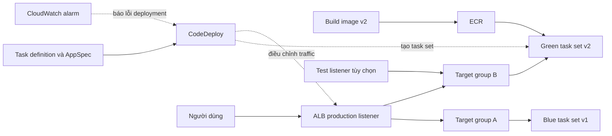

# Tìm hiểu luồng Blue/Green deployment — Tuần 1

**Đề tài:** Blue/Green deployment cho ECS với AWS CodeDeploy.

Tài liệu giải thích nguyên lý để chuẩn bị thiết kế và vấn đáp. Các ví dụ là tình huống dự kiến, chưa phải kết quả triển khai AWS.

## 1. Blue/Green là gì?

Trong một lần deployment:

- **Blue:** phiên bản đang phục vụ người dùng.
- **Green:** phiên bản mới được chạy và kiểm tra trước khi thay thế blue.

Ứng dụng cũ tiếp tục phục vụ trong lúc chuẩn bị bản mới. Khi bản mới đáp ứng điều kiện kiểm tra, traffic được chuyển sang green. Nếu triển khai gặp lỗi và rollback đã được cấu hình, hệ thống có thể giữ hoặc đưa traffic về bản tốt.

Với đề tài này, **một ECS service dùng controller `CODE_DEPLOY`**, có task set hiện tại và task set thay thế. Không cần tạo hai ECS service riêng. Hai target group A/B luân phiên phục vụ các phiên bản; A không cố định là blue. [Mô hình CodeDeploy blue/green](https://docs.aws.amazon.com/AmazonECS/latest/developerguide/migrate-codedeploy-to-ecs-bluegreen.html).

## 2. Các thành phần cần hiểu

| Thành phần | Vai trò trong bài |
| --- | --- |
| Docker image / ECR | Đóng gói ứng dụng và lưu image để ECS lấy về |
| Task definition | Mô tả image, container, port, CPU/RAM và role |
| ECS task / task set | Task chạy container; task set nhóm các task phục vụ một phiên bản trong deployment |
| ECS service | Duy trì số task cần chạy |
| ALB / listener | Nhận request và định tuyến traffic |
| Hai target group | Tách các target của bản hiện tại và bản thay thế |
| CodeDeploy | Điều phối tạo task set mới, chuyển traffic và rollback |
| CloudWatch | Ghi log, theo dõi metric và đánh giá alarm |

**Production listener** nhận traffic người dùng; **test listener** là lựa chọn bổ sung để thử bản mới trước khi chuyển production. [Các thành phần của ECS deployment](https://docs.aws.amazon.com/codedeploy/latest/userguide/deployment-steps-ecs.html).

## 3. Luồng triển khai và sơ đồ

1. Build ứng dụng v2 thành image và push vào ECR.
2. Đăng ký task definition mới trỏ tới image đó.
3. Tạo `appspec.yaml` xác định task definition ARN, container name và port.
4. Tạo deployment qua CodeDeploy; hệ thống tạo green task set và gắn target group còn lại.
5. Kiểm tra health; nếu có test listener, thử v2 qua listener này.
6. Khi đủ điều kiện, chuyển production traffic theo cấu hình deployment.
7. Nếu thành công, green trở thành bản đang phục vụ; task set cũ được dọn theo cấu hình.

AppSpec mô tả bản cần triển khai; cấu hình cluster/service, target groups, listeners và rollback nằm trong deployment group. [ECS AppSpec Resources](https://docs.aws.amazon.com/codedeploy/latest/userguide/reference-appspec-file-structure-resources.html).

Sơ đồ mô tả một lần triển khai: ban đầu production đi A; khi canary có thể chia traffic giữa A/B; sau thành công production đi B. Lần sau vai trò có thể đổi. [Cách CodeDeploy quản lý task set và routing](https://docs.aws.amazon.com/AmazonECS/latest/developerguide/migrate-codedeploy-to-ecs-bluegreen.html).

## 4. Chuyển traffic: ví dụ v1 → v2

| Cách chuyển | Ý nghĩa |
| --- | --- |
| All-at-once | Chuyển toàn bộ traffic sang bản mới trong một lần |
| Canary | Chuyển một phần nhỏ trước, chờ rồi chuyển phần còn lại |
| Linear | Chuyển từng phần đều nhau theo khoảng thời gian |

Ví dụ dùng `CodeDeployDefault.ECSCanary10Percent5Minutes`:

- Ban đầu: v1 nhận 100%, v2 chưa nhận production traffic.
- Khi v2 sẵn sàng: v1 nhận 90%, v2 nhận 10%.
- Sau năm phút, nếu deployment tiếp tục bình thường: v2 nhận 100%.

Đây là tỷ lệ routing được cấu hình; mẫu request nhỏ không nhất thiết cho đúng tỷ lệ 90/10. [Các cấu hình traffic của ECS CodeDeploy](https://docs.aws.amazon.com/AmazonECS/latest/developerguide/deployment-type-bluegreen.html).

## 5. Health check, alarm và rollback

**Health check** kiểm tra khả năng phục vụ của target, chẳng hạn gọi `/health` và mong đợi HTTP 200. **Alarm** đánh giá metric theo ngưỡng; alarm phải được liên kết với deployment group để CodeDeploy theo dõi. [CloudWatch alarms trong CodeDeploy](https://docs.aws.amazon.com/codedeploy/latest/userguide/monitoring-create-alarms.html).

| Tình huống demo | Điều cần quan sát |
| --- | --- |
| v2 trả 503 ở `/health` trước khi nhận traffic | Green unhealthy; production vẫn phục vụ bản tốt; xác nhận deployment bị dừng/thất bại và rollback theo cấu hình |
| v2 healthy nhưng trả 500 khi xử lý request | Green đã nhận traffic; alarm lỗi kích hoạt; xác nhận traffic quay về bản tốt |

Health check lỗi không đồng nghĩa rollback diễn ra ngay. Cần bật rollback theo điều kiện thất bại/alarm và xác minh deployment events. Nếu bản lỗi chưa nhận traffic, không trình bày kết quả như traffic đã chuyển rồi quay lại. [Rollback của ECS CodeDeploy](https://docs.aws.amazon.com/codedeploy/latest/userguide/deployment-steps-ecs.html).

Mục tiêu là hạn chế gián đoạn; khi thực hành vẫn phải đo request lỗi và timeout. Trong lúc deployment, hai task set cùng tồn tại nên cần tính thêm tài nguyên và chi phí. Rollback traffic cũng không tự hoàn tác thay đổi dữ liệu ứng dụng.

## 6. Những câu cần giải thích được

- **Vì sao hai target group?** Để định tuyến riêng bản hiện tại và bản mới.
- **Ai chuyển traffic?** CodeDeploy điều phối thay đổi routing của ALB.
- **AppSpec dùng làm gì?** Chỉ định task definition và container/port của bản triển khai.
- **Healthy có đảm bảo ứng dụng đúng không?** Không; cần thêm kiểm thử chức năng và giám sát lỗi.
- **Sau thành công, v2 là gì ở lần deploy tiếp?** Là bản hiện tại, tức blue của lần triển khai mới.

Đọc lại và tự giải thích các câu trên trước khi chuyển sang thiết kế kiến trúc. Tài liệu được AI hỗ trợ tổng hợp, đối chiếu tài liệu AWS ngày 10/10/2026; chưa xác nhận nhóm đã thực hiện deployment hoặc mỗi thành viên đã hiểu toàn bộ nội dung.
