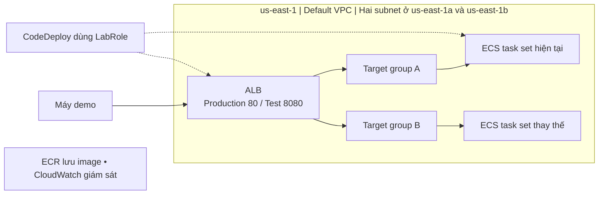

# 3 Tìm hiểu và thiết kế kiến trúc

Blue là phiên bản hiện tại, green là bản thay thế. CodeDeploy tạo task set mới, kiểm tra health và điều chỉnh traffic qua ALB. Hai target group A/B đổi vai trò giữa các lần triển khai. Rollback theo điều kiện thất bại hoặc alarm phải được cấu hình và xác minh bằng deployment events.

Thiết kế dự kiến dùng một ECS service với controller CODE_DEPLOY, Fargate 0,25 vCPU / 512 MiB, desired count 1; hai target group loại ip, HTTP 8080. Chọn canary 10% trong năm phút, rồi chuyển phần còn lại nếu deployment tiếp tục bình thường.

Hình 1  Kiến trúc blue/green dự kiến trên ECS.

[Quay lại mục lục báo cáo tuần 1](README.md)
