# 6 Minh chứng

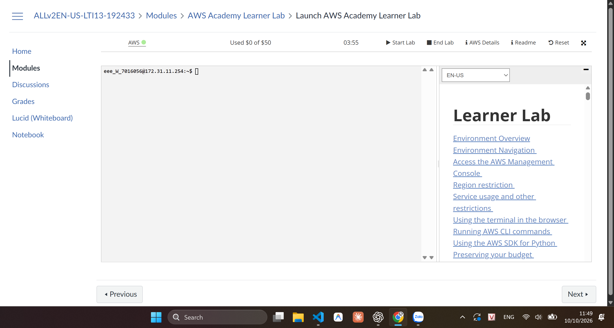

Hình 2  Trạng thái Learner Lab và ngân sách.

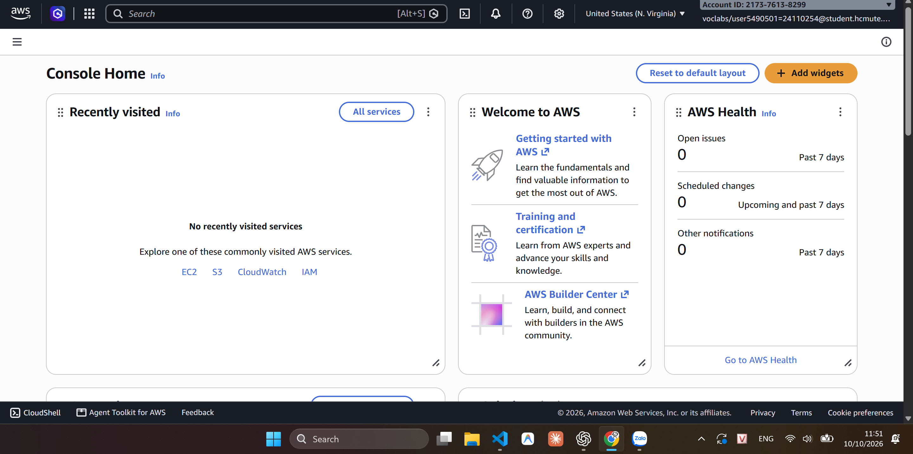

Hình 3  AWS Console và Region us-east-1.

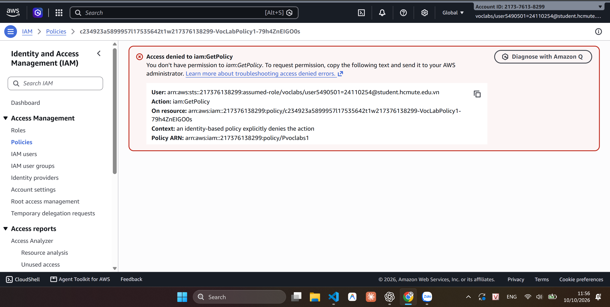

Hình 4  Lỗi quyền đọc IAM policy.

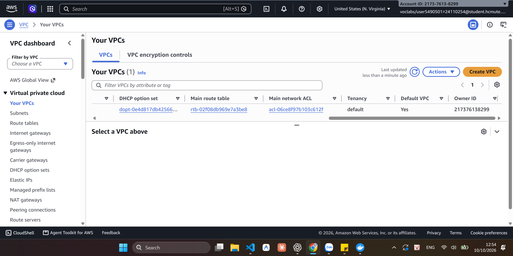

Hình 5  Default VPC có sẵn.

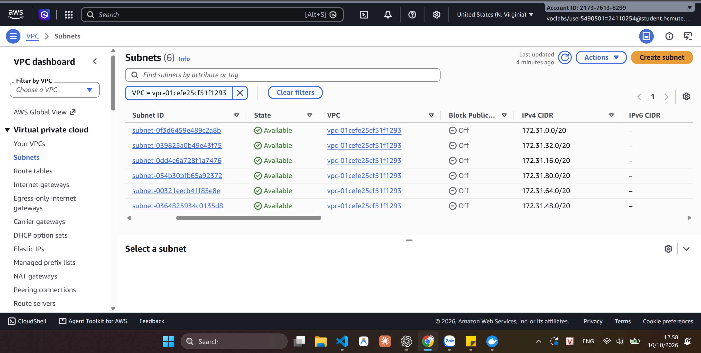

Hình 6  Danh sách subnet và CIDR.

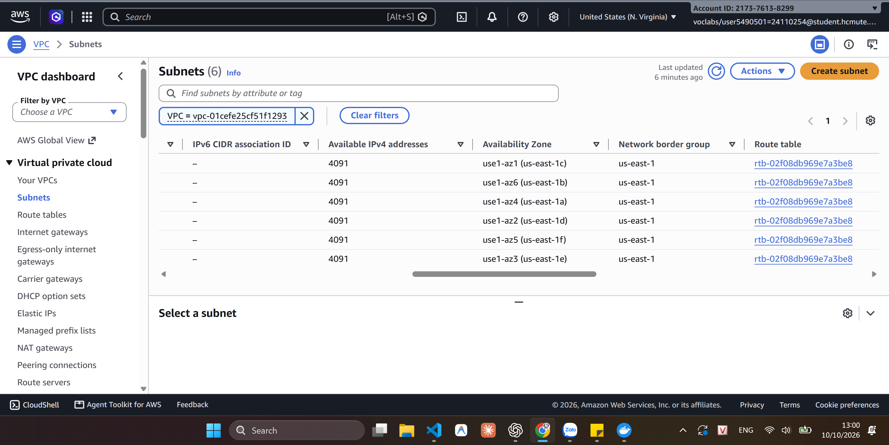

Hình 7  Availability Zones và route table.

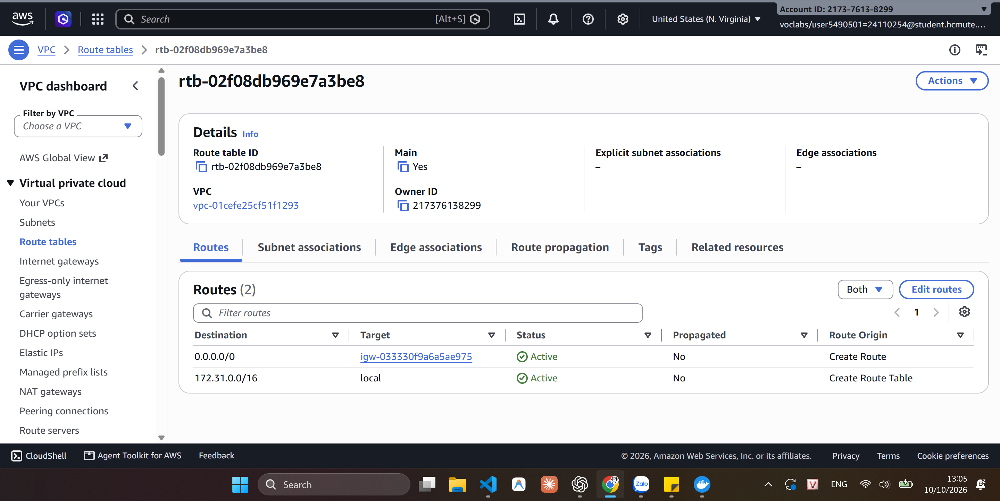

Hình 8  Route ra Internet ở trạng thái Active.

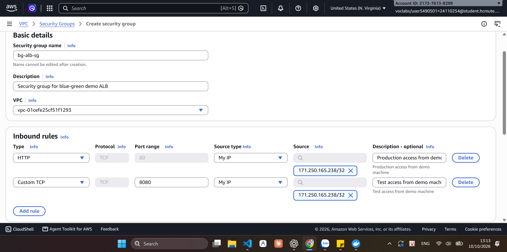

Hình 9  Form cấu hình inbound của bg-alb-sg.

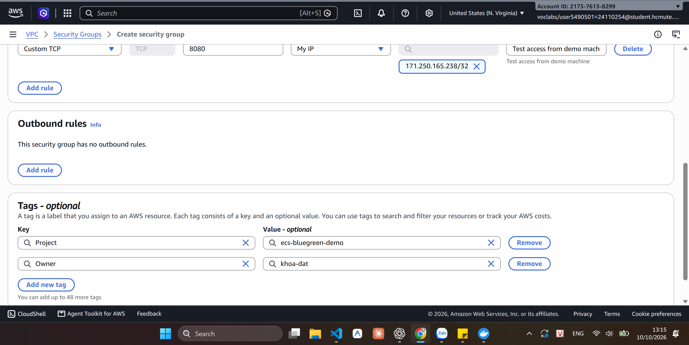

Hình 10  Form điền tags Project/Owner cho bg-alb-sg.

Hình 11  Tạo bg-alb-sg thành công.

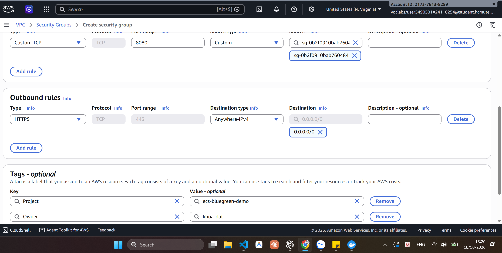

Hình 12  Form cấu hình rules và tags của bg-task-sg.

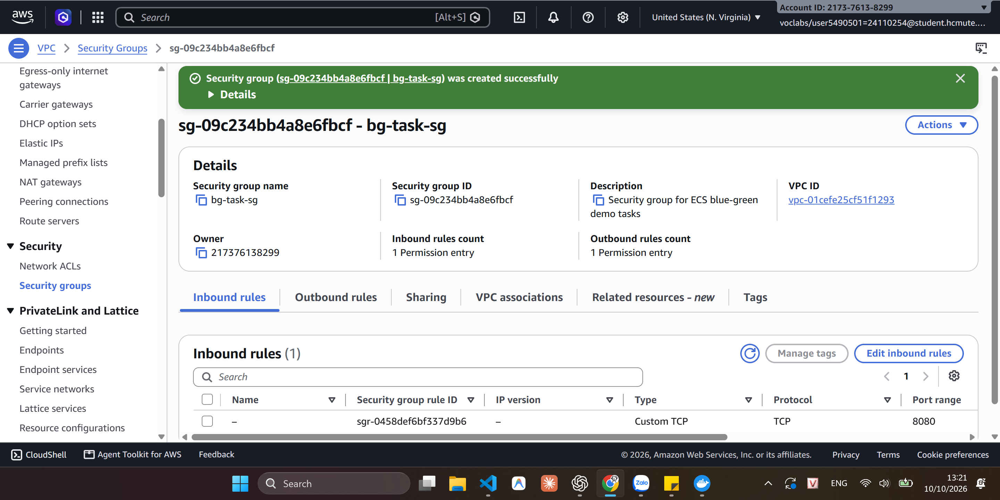

Hình 13  Tạo bg-task-sg thành công.

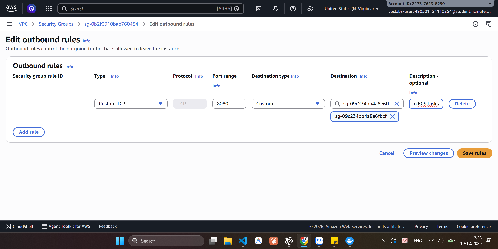

Hình 14  Form cấu hình outbound TCP 8080 tới bg-task-sg.

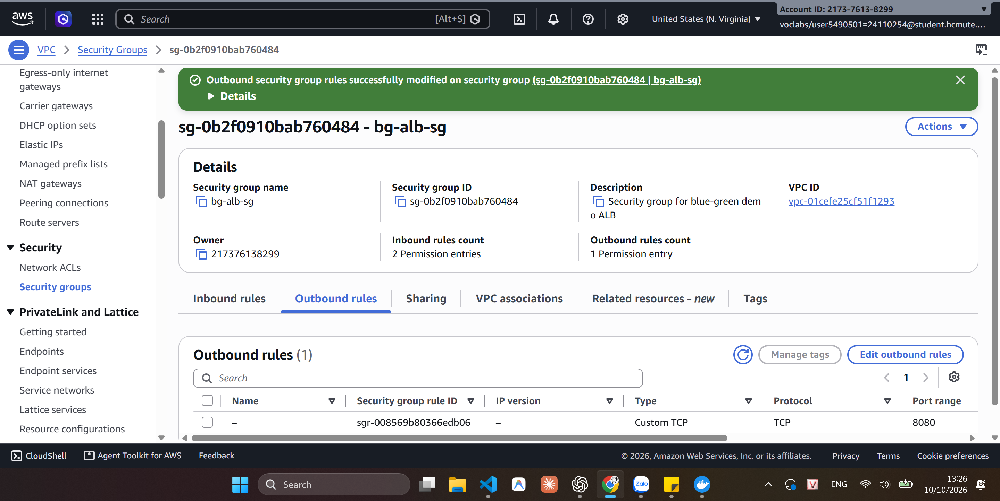

Hình 15  Lưu outbound của bg-alb-sg thành công.

[Quay lại mục lục báo cáo tuần 1](README.md)
